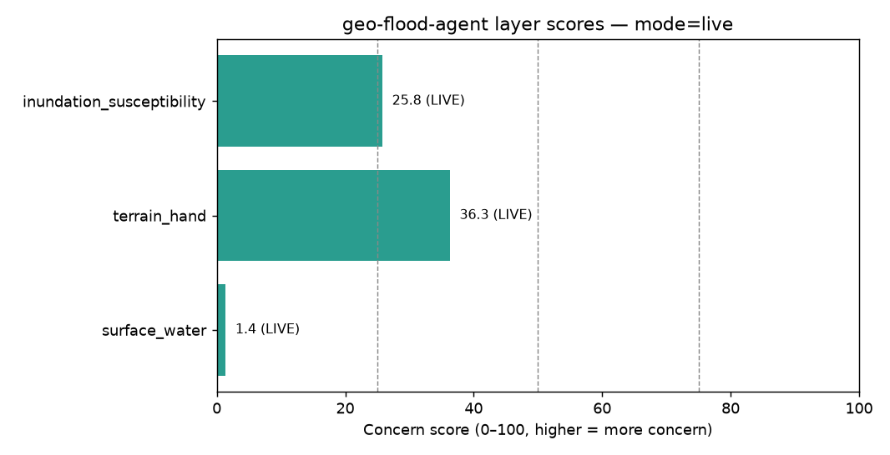
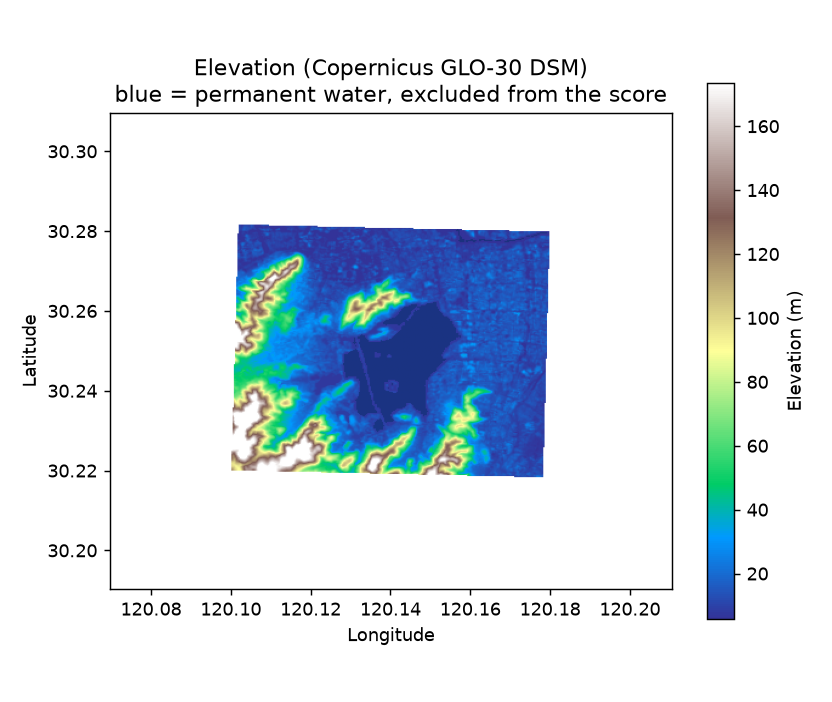
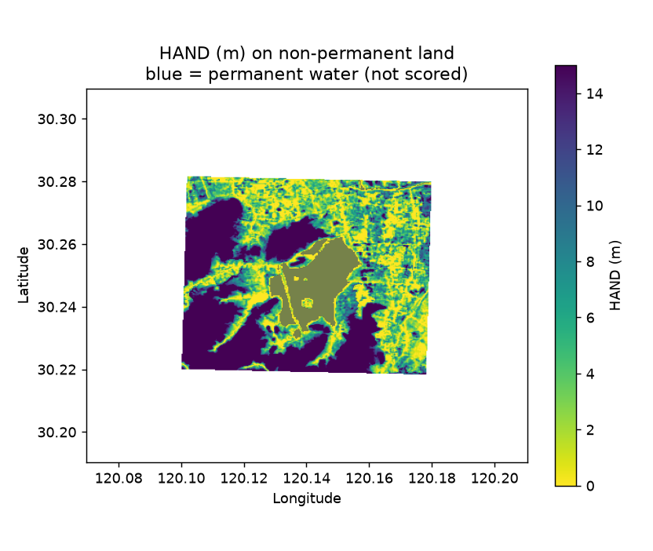
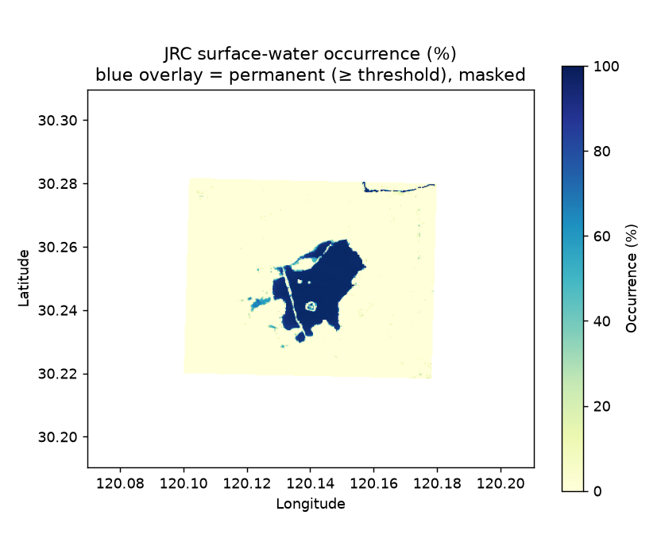
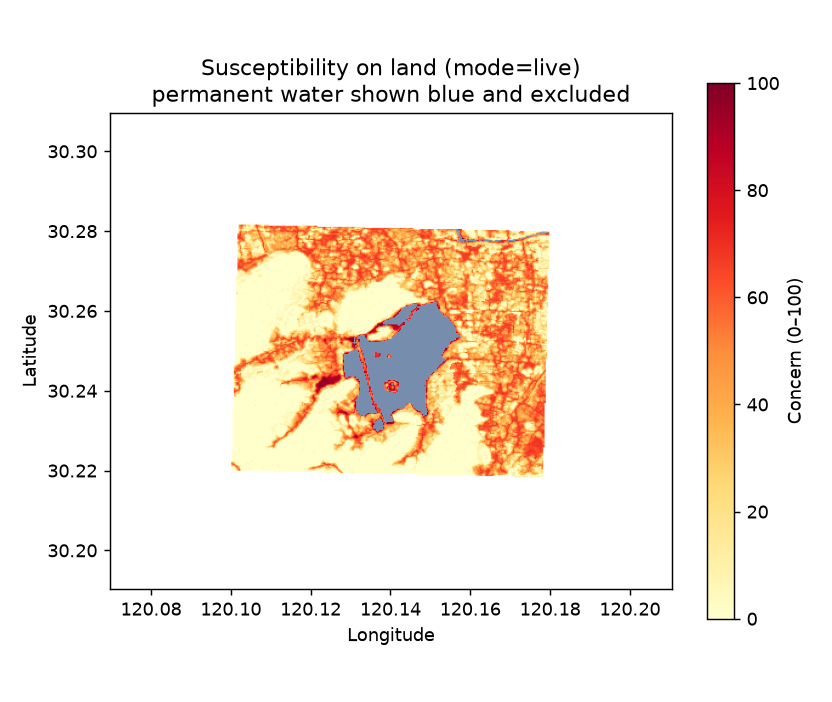
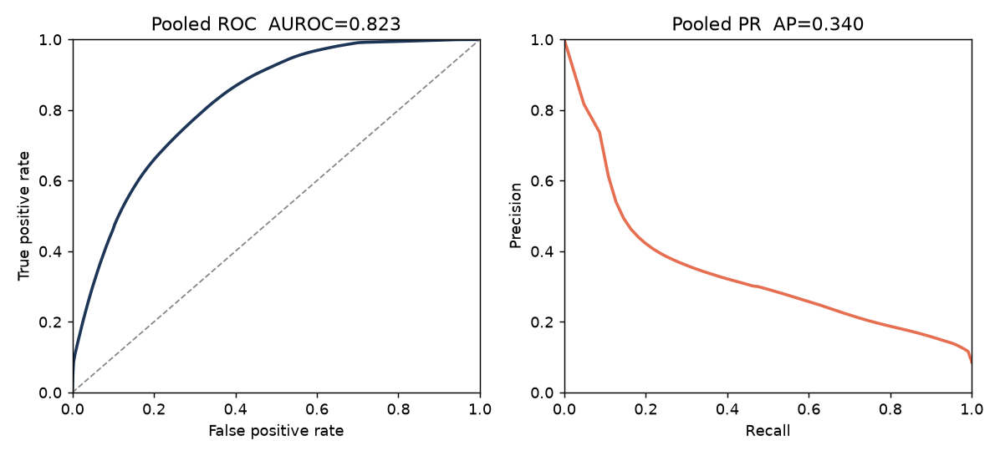
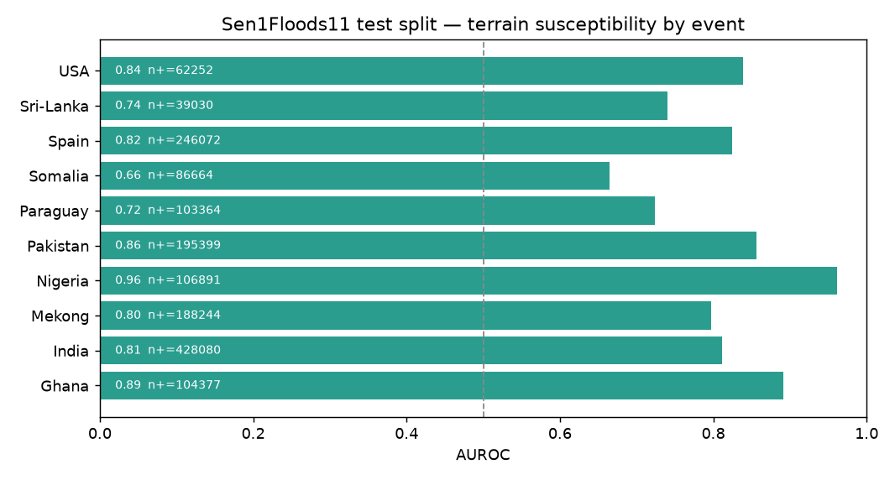

# geo-flood-agent

**AOI in → bilingual (EN/ZH) flood / inundation screening memo, GeoJSON, `summary.json`, and figures.**

The core path uses free public data and runs on a CPU (tested here with Python 3.12). `--demo` needs no API key and does not use the network.

An optional [Geoapify](https://www.geoapify.com) place query reads `GEOAPIFY_API_KEY` and adds a geocoded AOI, nearby places, and a travel-time isoline. Those records are location context. They are not flood depth. See [Geoapify place context](#geoapify-place-context).

> **What a live run is.** Copernicus DEM GLO-30 (a digital surface model) is turned into height above nearest drainage (HAND) and slope. JRC Global Surface Water occurrence supplies a permanent-water mask and a historical-wetness layer. The composite is the mean susceptibility on **land that is not permanent water**. It is a screening index. It is not a hydraulic flood depth, not a forecast, and not an official floodplain.
>
> **`--demo` never touches the network.** Every layer is then labeled **MOCK**.

---

## Problem

Site screening needs a fast, inspectable inundation signal before a hydraulic study: an AOI goes in, and a scored memo comes out, with each layer tagged MOCK or LIVE and with the numbers traceable to a tool output.

The previous version scored a MOCK hydrology heuristic from the AOI centroid, and it treated a 5×5 grid of elevations as terrain. On the Hangzhou sample that grid was coarse enough to call West Lake “low-lying flood-prone land.” This version replaces both of those with rasters, and it checks the terrain score against hand-labeled flood water.

## Data

| Layer | Source | What was actually transferred |
|-------|--------|-------------------------------|
| Terrain | [Copernicus DEM GLO-30](https://registry.opendata.aws/copernicus-dem/) public COGs, AWS bucket `copernicus-dem-30m` (eu-central-1), no credentials. 2021 release. DSM, ~30 m. | Sample AOI: **3,415,324 bytes** of HTTP GET bodies (range reads). The `N30E120` object is 47,859,448 bytes and was not downloaded whole. |
| Surface water | [JRC Global Surface Water](https://global-surface-water.appspot.com/) occurrence, Planetary Computer collection `jrc-gsw`, COG v1.3 (1984–2020). Public SAS signing, no account key. | Same live run. Largest HEAD Content-Length seen: 96,601,892 bytes (the 10° occurrence COG), windowed, not downloaded whole. |
| Observed floods | [Sen1Floods11](https://github.com/cloudtostreet/Sen1Floods11) v1.1 hand labels (`LabelHand`) and the dataset’s permanent-water chips (`JRCWaterHand`), public GCS. Official test split `flood_test_data.csv`. | **601,535 bytes** of GeoTIFFs for all 90 test chips. |
| Validation DEM | Same Copernicus GLO-30 windows, one buffered chip at a time. | **395,924,324 bytes** of HTTP GET bodies (~378 MiB) across 90 chips. Largest source object header: 48,614,529 bytes. |

Live sample + full test-split validation is about **381 MiB** of GET bodies. Cache lives in `.cache/` (gitignored).

Citations: Pekel et al. 2016, *Nature* (JRC GSW); Copernicus DEM licence; Bonafilia, Tellman, Anderson, Issenberg 2020, CVPR Workshops (Sen1Floods11).

## Method

Parameters below were fixed in `src/geo_flood_agent/constants.py` before the validation run. They were not tuned on the test split.

1. Validate the AOI with Shapely. Reject a box larger than 5° on a side.
2. Build a local UTM grid at 30 m covering the AOI plus a **3 km** buffer (resolution coarsens only if a side would exceed 1200 pixels). The buffer exists so D8 flow is not cut off on the AOI boundary.
3. Read Copernicus GLO-30 with HTTP range requests and bilinearly resample it onto that grid.
4. **HAND and slope.** Priority-flood with a tiny epsilon so flats drain (Barnes, Lehman, Mulla 2014), D8 steepest descent and accumulation (O’Callaghan and Mark 1984), HAND as the original elevation minus the downstream drainage elevation, clipped at 0 (Nobre et al. 2011). Drainage cells are those with upstream area ≥ **0.5 km²**. Slope is the gradient of the original DEM, in degrees. The implementation is NumPy plus rasterio (unit-tested on a synthetic valley). pysheds / Whitebox / richdem implement the same family of algorithms; they were not used, so the Mac install stays a pip wheel set (rasterio already carries GDAL).
5. **Permanent water.** JRC occurrence ≥ **80%** is masked. Those pixels are reported (area, fraction) and are excluded from every score. The sample AOI centroid falls on West Lake; see below.
6. **Terrain concern** on remaining land, 0–100: `80% × clip((10 − HAND) / 10, 0, 1) + 20% × clip((5 − slope) / 5, 0, 1)`.
7. **Water concern** on remaining land: occurrence / 80, scaled to 0–100. This is multi-year wetness, so the screening composite may use it, but the **validation score does not** (occurrence history can contain the floods being scored).
8. **Composite:** mean over non-permanent land of `0.70 × terrain + 0.30 × water`. If one live source fails, that layer is labeled MOCK and is left out of the composite. A MOCK number does not drive the score.
9. **Planner.** Default is a fixed tool sequence (`analyze_terrain` → `analyze_surface_water` → `score_susceptibility`), written to `tool_trace.json`. `--llm` sends those tools to any OpenAI-compatible `/chat/completions` endpoint (OpenAI or a local Ollama server). The model may draft the narrative. A draft that cites a number which is not a rounding of a tool output is rejected, and the deterministic narrative is kept. This verification run used the deterministic planner (`llm_enabled: false`).

## Sample AOI (this live run)

`examples/sample_aoi.geojson` — 120.10–120.18°E, 30.22–30.28°N, about 51.4 km², Hangzhou, including West Lake. Command: `--mode live`. Wall clock **8.4 s**. Mode `live`, 3 LIVE / 0 MOCK. Planner `deterministic`.

| Layer | Score | Kind |
|-------|------:|------|
| `surface_water` | 1.4 | LIVE |
| `terrain_hand` | 36.3 | LIVE |
| `inundation_susceptibility` (composite) | **25.8** (moderate) | LIVE |

Raster summaries on this run:

| Quantity | Value |
|----------|------:|
| Elevation mean / median inside the AOI | 34.07 m / 15.18 m |
| HAND on non-permanent land, median / mean | 6.62 m / 23.44 m |
| Slope mean on that land | 8.06° |
| Land scored | 46.28 km² (51,422 px at 30 m) |
| Permanent water (occurrence ≥ 80%) | **4.99 km² (9.74% of the AOI)** |
| Land with HAND < 2 m | 22.52% of scored land |
| Share of AOI pixels with HAND < 2 m that are permanent water | **32.31%** (excluded) |
| Unresolved HAND | 0% |
| Composite p90 on land | 60.8 |

**West Lake.** The AOI centroid (120.14°E, 30.25°N) samples occurrence **97%**, elevation **7.5 m**, HAND **0 m**, `permanent_water=true`, `included_in_score=false`. The lake is drawn and masked. It is not a flood-prone land pixel. The low water-layer score (1.4) is the historical wetness of the *remaining* land: once the lake is removed, most of the AOI was rarely mapped as water. Terrain still carries the low HAND ground around it (terrain score 36.3; composite 25.8).











`--demo` on the same AOI is unchanged as a geometry heuristic: hydrology proxy 39.1, terrain proxy 54.6, composite 45.1, all MOCK. See `examples/sample_output/`.

## Validation

**Question.** Does the terrain concern rank hand-labeled flood water above dry land, on pixels that are not permanent water?

**Setup.** All 90 chips in the Sen1Floods11 **hand-labeled test split** (10 events, file order, not chosen by score). Score = the terrain concern above, resampled bilinearly onto the 10 m label grid. Permanent water = `JRCWaterHand > 0`. Label `-1` is nodata. JRC occurrence is **not** a predictor. Operating point score ≥ 50 was pre-specified.

**Coverage.** 82 chips entered the metrics. 8 were skipped because a chip must contain both flooded and non-flooded land after the mask: 6 had dry land and no flood pixels, 1 (Ghana) had no valid land pixels, and 1 (Paraguay) was entirely flooded land. Skipped chips do not contribute pixels. Pooled N = 18,275,983 land pixels (1,560,373 flooded, prevalence 0.085). Wall clock about **2 min 40 s** from the first label file to `validation_summary.json`.

### Pooled

| Metric | Value |
|--------|------:|
| AUROC | **0.823** |
| Average precision | **0.340** |
| Prevalence (AP of an uninformative score) | 0.085 |
| Macro AUROC (unweighted mean of 10 events) | 0.811 |
| Precision at score ≥ 50 | 0.138 |
| Recall at score ≥ 50 | 0.955 |

### By event

| Event | Chips scored | Flood pixels | Dry land pixels | AUROC | AP |
|-------|-------------:|-------------:|----------------:|------:|---:|
| Ghana | 7 | 104,377 | 1,400,435 | 0.891 | 0.561 |
| India | 13 | 428,080 | 2,248,686 | 0.812 | 0.476 |
| Mekong | 6 | 188,244 | 1,242,872 | 0.797 | 0.332 |
| Nigeria | 4 | 106,891 | 636,842 | 0.961 | 0.760 |
| Pakistan | 5 | 195,399 | 824,366 | 0.857 | 0.501 |
| Paraguay | 12 | 103,364 | 2,844,162 | 0.723 | 0.096 |
| Somalia | 6 | 86,664 | 1,240,014 | 0.665 | 0.107 |
| Spain | 6 | 246,072 | 1,124,201 | 0.824 | 0.481 |
| Sri-Lanka | 9 | 39,030 | 1,627,131 | 0.741 | 0.068 |
| USA | 14 | 62,252 | 3,526,901 | 0.838 | 0.147 |





**How to read this.** AUROC 0.823 means a flooded land pixel outranks a dry land pixel about 82% of the time. Average precision 0.340 is above the 0.085 prevalence baseline and is pulled down by rare-flood scenes (Sri-Lanka, Paraguay, Somalia, USA). The score ≥ 50 threshold recalls 95.5% of flooded land and is precise on only 13.8% of its alarms: HAND lights up susceptible ground that this particular Sentinel-1 scene did not inundate. That is what a susceptibility index does. It is not a detector of one flood date. Somalia is the weakest event (AUROC 0.665). Nigeria is the strongest (0.961). No threshold or HAND cap was adjusted after seeing these numbers.

## Geoapify place context

The screening math does not use Geoapify. Copernicus HAND and JRC occurrence are unchanged. [Geoapify](https://www.geoapify.com) supplies three optional location facts. A block is tagged **LIVE** only when that call returned data that this program parsed. A failed call is **UNAVAILABLE**. An isoline that is accepted but not finished is **PENDING**. Nothing is filled in with a guessed name or a circle.

1. **Geocoding.** `GET https://api.geoapify.com/v1/geocode/search` (`text`, `format=geojson`, `bias=countrycode:none`). Docs: [forward geocoding](https://apidocs.geoapify.com/docs/geocoding/forward-geocoding/).
2. **Nearby places.** `GET https://api.geoapify.com/v2/places` with a `circle:lon,lat,radiusMeters` filter and `bias=proximity:lon,lat`. Docs: [Places API](https://apidocs.geoapify.com/docs/places/). Default categories are hospitals, schools, universities, fire stations, ambulance stations, police, train stations, and subway stations.
3. **Travel-time isoline.** `GET https://api.geoapify.com/v1/isoline` with `type=time` (range in seconds), `mode`, and `traffic=free_flow`. Docs: [Isoline API](https://apidocs.geoapify.com/docs/isolines/). The polygon is the reachable area for that trip. It is not a flood extent and not a flood depth.

The client is the Python standard library calling those REST endpoints (the same query names as the [OpenAPI specs](https://apidocs.geoapify.com/)). It does not call the MCP server during a screening run.

The free plan is about 3000 requests per day. One `--place` run is a geocode, a places search, and one isoline, plus a single follow-up if the isoline comes back HTTP 202. The unit tests mock HTTP and do not spend that quota.

### Key

`--demo` does not read a key.

`--place` reads `GEOAPIFY_API_KEY`. If it is missing, the process exits with an error and does not invent an AOI. The Open Geospatial Program demo key is in `.env.example` with Geoapify’s note (free plan, limited use). Copy what you need into `.env` (gitignored) or export it. For your own projects, create a key at [myprojects.geoapify.com](https://myprojects.geoapify.com).

```bash
export GEOAPIFY_API_KEY=...   # see .env.example; do not commit .env
```

`python-dotenv` loads a local `.env` when it is installed. The client still reads the variable from the environment. If dotenv is absent, an exported variable is enough.

### Commands

Offline demo first (no key, no network):

```bash
python -m geo_flood_agent --demo --out examples/sample_output
```

A place query builds an AOI and runs the existing screening. Flood layers stay MOCK unless you pass `--mode live`. Geoapify sections are LIVE when those calls succeed. The AOI is the geocoder bbox when both sides are between 400 m and 8 km, otherwise a square buffer around the point (`--aoi-buffer-m`, default 2000). That polygon is not the hand-drawn sample AOI, so the MOCK composite will not be 45.1.

```bash
# Geocode + nearby places + 10-minute drive isoline
python -m geo_flood_agent --place "West Lake, Hangzhou" --out output/place_demo

# Same place, Copernicus HAND + JRC occurrence (downloads COG windows)
python -m geo_flood_agent --place "West Lake, Hangzhou" --mode live --out output/place_live

# Geocode and nearby places only
python -m geo_flood_agent --place "West Lake, Hangzhou" --no-isoline --out output/place_no_isoline

# Walk isoline, 15 minutes, tighter places radius
python -m geo_flood_agent --place "West Lake, Hangzhou" \
  --travel-mode walk --isoline-min 15 --places-radius-m 1500 \
  --out output/place_walk
```

`--list-tools` prints `geocode_place`, `search_nearby_places`, and `travel_time_isoline` with the flood tools. Those three are not part of the `--demo` trace.

| Tool | REST |
|------|------|
| `geocode_place` | Geocoding API |
| `search_nearby_places` | Places API |
| `travel_time_isoline` | Isoline API, `type=time` |

### MCP (optional, for an AI client)

Screening runs use REST. An AI client that should call Geoapify itself still needs the MCP server. Endpoint: `https://api.geoapify.com/v1/mcp`. Docs: [MCP server](https://apidocs.geoapify.com/docs/mcp/) and [connect an AI client](https://apidocs.geoapify.com/how-to/api-tooling-ai/connect-ai-client-mcp/).

A Cursor snippet that references the environment variable, and does not contain a key, is [`docs/geoapify-mcp.json.example`](docs/geoapify-mcp.json.example). Put the real key in the environment that starts the client (`GEOAPIFY_API_KEY`). Do not paste it into the JSON file. Geoapify also documents `https://api-eu.geoapify.com/v1/mcp`. This package’s REST client uses `https://api.geoapify.com`.

Reviewer walkthrough (offline `--demo`, then `--place`): [`docs/walkthrough.md`](docs/walkthrough.md).

Prompts for this slice, including one that had to be corrected when the isoline moved into this PR: [`docs/prompts.md`](docs/prompts.md).

## LLM setup

Default: no model is called.

```bash
# Ollama on the Mac mini (OpenAI-compatible)
export GEO_FLOOD_LLM=1
export OPENAI_BASE_URL=http://127.0.0.1:11434/v1
export OPENAI_API_KEY=ollama
export OPENAI_MODEL=llama3.2

python -m geo_flood_agent --aoi examples/sample_aoi.geojson --mode live --llm --out output/live_llm
```

OpenAI uses the same variables with `OPENAI_BASE_URL=https://api.openai.com/v1` and a real key. If the endpoint errors, or the draft contains a number that is not in the tool JSON, `tool_trace.json` records `fallback_reason` and the memo keeps the deterministic narrative. Tables are always filled from tools.

## Limitations

- Copernicus GLO-30 is a **surface** model. Canopy and buildings are in the elevation, so urban HAND is not bare-earth HAND.
- D8 on a 30 m UTM grid with a 0.5 km² channel threshold and a 3 km buffer is a local approximation. The sample AOI had no unresolved HAND cells; a basin larger than the buffer can still truncate flow paths.
- The 10 m HAND cap and the 80% permanent-water threshold are screening choices, not calibrated flood frequencies.
- JRC occurrence in the **screening** composite is historical wetness. It is weak on the sample once the lake is masked (score 1.4), which is expected, and it is deliberately absent from the validation score.
- Validation covers the Sen1Floods11 test split only (11 countries’ events in that file, 82 usable chips). It does not measure performance outside those scenes, and it does not test the water-history term.
- There is no rainfall, no hydrograph, and no forecast.
- Do not use the memo for engineering, insurance, or regulatory decisions.
- Geoapify place names and the travel-time polygon are context from that API. They do not measure water. The isoline is a reachable area for a mode and a duration (`traffic=free_flow` unless you change the client). It is not a flood extent.

## Reproduce (macOS, Python 3.12)

From the repository root. Rasterio’s wheel supplies GDAL; a separate GDAL install is unnecessary. `--demo` needs no API key.

```bash
python3 -m venv .venv
source .venv/bin/activate
python -m pip install -U pip
python -m pip install -r requirements.txt
python -m pip install -e .

# Offline MOCK demo (no network, no Geoapify key). Checked-in sample memo is the v0.3.0 run;
# this command still scores that same AOI (composite 45.1, all MOCK).
python -m geo_flood_agent --demo --out examples/sample_output

# Place context (needs GEOAPIFY_API_KEY; see the Geoapify section). Flood layers stay MOCK
# unless you also pass --mode live. The geocoded AOI is not the hand-drawn sample polygon.
python -m geo_flood_agent --place "West Lake, Hangzhou" --out output/place_demo

# Live screening: Copernicus GLO-30 HAND + JRC occurrence, sample AOI
python -m geo_flood_agent --aoi examples/sample_aoi.geojson --mode live --out output/live_demo

# Validation: full Sen1Floods11 hand-labeled test split (about 380 MiB of COG windows + labels)
python -m geo_flood_agent --validate --out output/validation

# Optional: first 2 test chips per event, CSV order, still not chosen by score
# python -m geo_flood_agent --validate --validate-max-per-event 2 --out output/validation_small

python -m geo_flood_agent --list-tools

# Unit tests (no network). Geoapify calls are mocked.
python -m unittest discover -s tests
```

## Layout

```
src/geo_flood_agent/    CLI, deterministic + LLM planners, HAND, JRC mask, Geoapify REST, validation
examples/               sample AOI and the offline MOCK memo
docs/                   reviewer walkthrough, Geoapify prompts, MCP client snippet
figures/                live sample maps and validation curves from the run recorded above
tests/                  synthetic valley, metrics, mock scores, mocked Geoapify HTTP
```

**Tools:** `validate_aoi_geojson` · `validate_aoi_bbox` · `geocode_place` · `search_nearby_places` · `travel_time_isoline` · `analyze_terrain` · `analyze_surface_water` · `score_susceptibility` · `run_flood_screening` · `write_report` · `fetch_open_elevation`

## License

MIT for this code. Copernicus DEM, JRC Global Surface Water, and Sen1Floods11 keep their own terms. Do not commit `.env`, `.venv`, `.cache/`, or `output/`.
