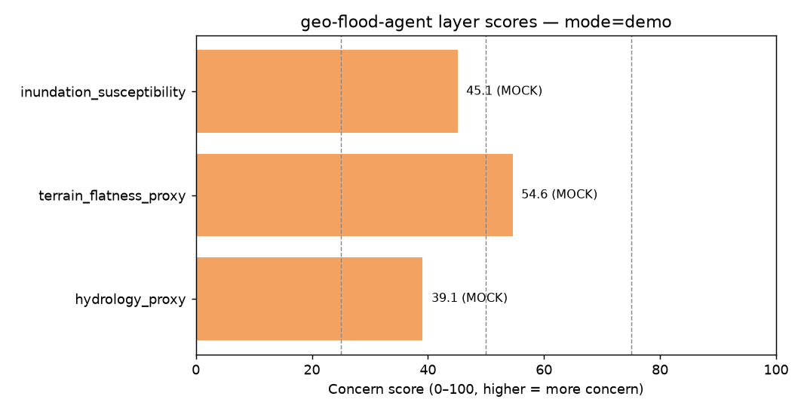

# Flood / Inundation Screening Report
# 洪水 / 淹没筛查报告

**Generated:** 2026-10-18 14:51:29 UTC  
**Tool:** geo-flood-agent v0.3.0  
**Mode:** `demo`  
**Planner:** `deterministic`

---

## Disclaimer / 免责声明

> **EN:** DATA MODE: MOCK / DEMO. Scores are deterministic heuristics from AOI geometry only. They are NOT live satellite or official floodplain products. Do not use for engineering, insurance, or regulatory decisions.

> **中文:** 数据模式：模拟 / 演示。分数仅由 AOI 几何的确定性启发式产生，并非实时卫星或官方淹没区产品。不得用于工程、保险或合规决策。

---

## AOI Summary / 兴趣区摘要

| Field | Value |
|------|-------|
| Source | `/workspace/examples/sample_aoi.geojson` |
| CRS | EPSG:4326 |
| Bounds (W,S,E,N) | 120.100000, 30.220000, 120.180000, 30.280000 |
| Centroid (lon, lat) | 120.140000, 30.250000 |
| Approx. area | 51.3829 km² |

---

## Composite Result / 综合结果

| Metric | Value |
|--------|-------|
| Composite score (0–100, higher = more concern) | **45.1** |
| Composite label | **moderate** |

The composite is the mean susceptibility on **non-permanent land**. Permanent water is masked. MOCK layers are not blended into a live composite.

### Interpretation (EN)
- `low` (<25): Relatively lower inundation concern for this AOI (screening only).
- `moderate` (25–49): Mixed signals; treat as screening-only.
- `elevated` (50–74): Elevated concern — prioritize real floodplain / hydraulic next steps.
- `high` (≥75): High concern — **still not engineering-grade**.

### 解读（中文）
- `low`（<25）：相对较低的淹没关注度（仅筛查）。
- `moderate`（25–49）：信号混合，仅作筛查。
- `elevated`（50–74）：关注度偏高 — 下一步应做真实洪泛区 / 水动力分析。
- `high`（≥75）：关注度高 — **仍非工程级**。

---

## Narrative / 叙述

**Source / 来源:** deterministic template (no LLM, or the LLM draft was rejected)

- EN: hydrology_proxy = 39.1 (moderate, MOCK). terrain_flatness_proxy = 54.6 (elevated, MOCK). inundation_susceptibility = 45.1 (moderate, MOCK). No elevation or water raster was read. These scores are geometry heuristics. Authoritative composite is 45.1 (moderate). This is a screening index, not a flood depth or a forecast.
- 中文: hydrology_proxy = 39.1（moderate，MOCK）。terrain_flatness_proxy = 54.6（elevated，MOCK）。inundation_susceptibility = 45.1（moderate，MOCK）。没有读取高程或水体栅格。这些分数是几何启发式。以表格为准的综合分是 45.1（moderate）。这是筛查指数，不是洪水水深，也不是预报。

---

## Terrain (HAND and slope) / 地形

_No continuous DEM in this run._

---

## Surface water / 地表水

_No JRC occurrence raster in this run._

---

## Layer Scores / 图层得分

| Layer | Score | Label | Kind | Data source |
|-------|-------|-------|------|-------------|
| `hydrology_proxy` | 39.1 | moderate | MOCK | MOCK (deterministic heuristic from AOI geometry) |
| `terrain_flatness_proxy` | 54.6 | elevated | MOCK | MOCK (bbox geometry proxy; no DEM fetched) |
| `inundation_susceptibility` | 45.1 | moderate | MOCK | MOCK (derived from mock layers) |

---

## Layer Notes / 图层说明

### `hydrology_proxy` (moderate, 39.1/100)

- EN: MOCK heuristic from AOI centroid latitude/longitude only. Not stream networks, not rainfall, not floodplain maps.
- 中文: 【模拟】仅用 AOI 中心点经纬度做启发式打分。不是河网、不是降雨、不是官方淹没区图。

### `terrain_flatness_proxy` (elevated, 54.6/100)

- EN: MOCK: bbox aspect ratio + area used as a stand-in for flatness. Use --mode live for Copernicus GLO-30 HAND and slope.
- 中文: 【模拟】用包围盒长宽比与面积代替地形平坦度。使用 --mode live 可计算 Copernicus GLO-30 的 HAND 与坡度。

### `inundation_susceptibility` (moderate, 45.1/100)

- EN: MOCK susceptibility blending hydrology_proxy + terrain proxy. NOT satellite water detection, NOT insurance flood zones.
- 中文: 【模拟】淹没易感性 = 水文代理与地形代理加权。不是卫星水体提取，也不是保险洪水区划。

---

## Parameters / 参数

These were fixed before looking at validation results.

| Parameter | Value |
|-----------|-------|
| `res_m` | 30.0 |
| `buffer_m` | 3000.0 |
| `stream_area_km2` | 0.5 |
| `hand_cap_m` | 10.0 |
| `slope_cap_deg` | 5.0 |
| `permanent_occurrence` | 80.0 |
| `w_terrain` | 0.7 |
| `w_water` | 0.3 |
| `w_hand` | 0.8 |
| `w_slope` | 0.2 |

HTTP GET bytes recorded for COG range reads this run: `0`.  
Largest HEAD Content-Length seen (full source object, not downloaded in full): `0`.

---

## Figures / 附图

---

## Method

1. Validate AOI (Shapely). Reject boxes larger than 5° on a side.
2. **Live terrain:** windowed read of Copernicus DEM GLO-30 COGs from the public AWS bucket, reprojected to the local UTM zone. Priority-flood (Barnes et al. 2014) + D8 (O'Callaghan & Mark 1984) + HAND (Nobre et al. 2011) and slope. The DEM is a DSM.
3. **Live water:** windowed read of JRC Global Surface Water occurrence (Planetary Computer COG). Occurrence ≥ threshold is permanent water and is removed from the land score.
4. **Composite:** mean of `0.7 * terrain + 0.3 * occurrence-wetness` on the remaining land. A failed source becomes a labeled MOCK layer and is left out of the composite.
5. **Planner:** deterministic tool sequence by default. With `--llm`, an OpenAI-compatible model calls the same tools and may draft the narrative; numbers that are not in the tool JSON are rejected.
6. Tool trace: `tool_trace.json`.

---

## What this is not

Not a hydraulic simulation, not a flood forecast, not an insurance zone, and not a substitute for a surveyed floodplain. Copernicus GLO-30 is a surface model (vegetation and buildings included). JRC occurrence is a multi-year water history, so it can include past floods; it is used here as context and as a permanent-water mask, not as proof of a future event.

---

*End of report. MOCK vs LIVE is labeled per layer. Do not present mock scores as observed flood maps.*
